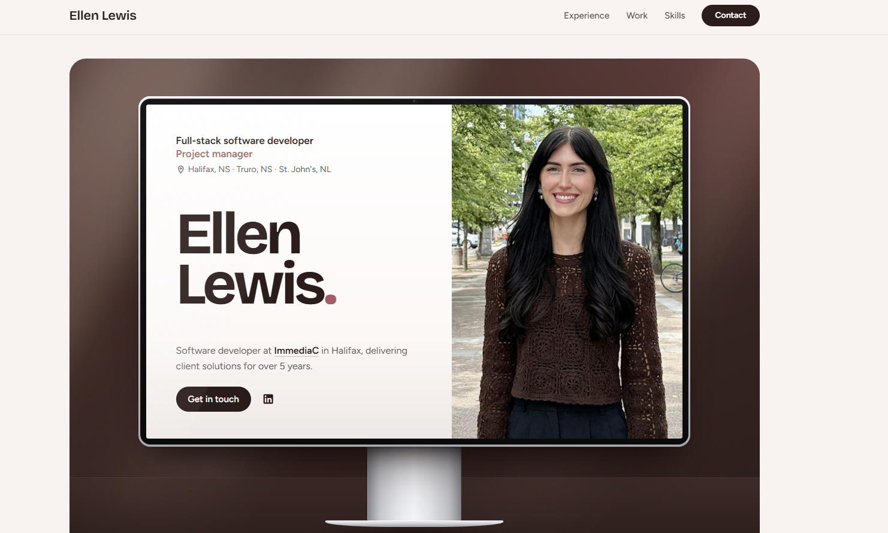

# Ellen Lewis Portfolio

**Live site:** [ellenlewis.netlify.app](https://ellenlewis.netlify.app)



My personal portfolio site covering my experience as a software developer, recent projects, education, volunteering and skills, and has a contact form.

## Tech stack

- **Next.js 15** (App Router), exported as a fully static site
- **React 19**
- **MUI 7** with Emotion, styled through the `sx` prop and a custom espresso and rose theme
- **Netlify** for hosting and form handling
- **pnpm** for packages

## Getting started

```bash
pnpm install
pnpm dev
```

Then open [http://localhost:3000](http://localhost:3000).

To build the static site:

```bash
pnpm build
```

The output goes to `out/`.

## Project structure

```
app/
  page.js                  Home page: experience, projects, education, skills
  contact/page.js          Contact form
  layout.js                Fonts, metadata and the site shell
  icon.svg                 Favicon
  components/
    providers.js           MUI theme
    navigation.js          Header and footer
    deviceMockup.js        Monitor and scene used in the hero
    experienceTimeline.js  Clickable work timeline
    techList.js            Technology tags
    *Screen.js             Code-drawn project mockups
public/
  images/                  Profile photo and project screenshots
  __forms.html             Hidden form so Netlify can detect the contact form
  _headers                 Netlify response headers
```

Most content (experience, projects, volunteering, skills) is stored as data arrays at the top of `app/page.js`. Edit those arrays to update the site.

## Deployment

The site deploys to Netlify as a static export (`output: "export"` in `next.config.mjs`). The contact form posts to `/__forms.html`, which Netlify Forms picks up at build time.

## Client work

Client projects were built at [ImmediaC](https://immediac.com), which owns that work, and each one links to ImmediaC's case study where available. The NSTU screens come from ImmediaC's published case study and use test data. All other project images are illustrative mockups drawn in code, not real product screens or client data.
